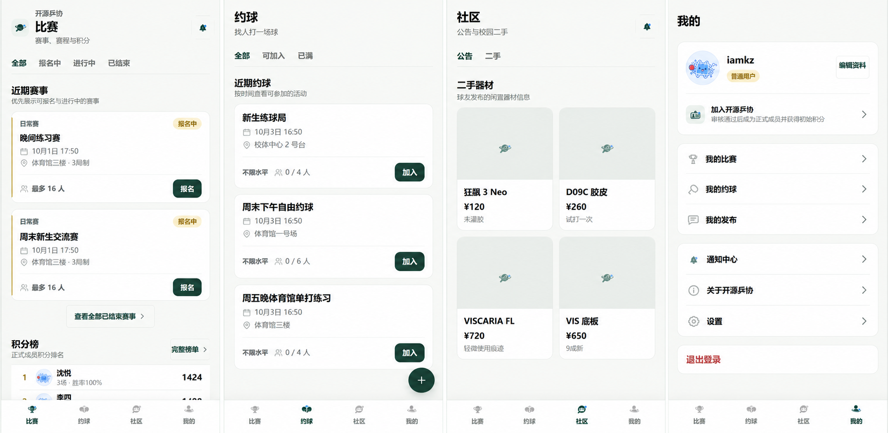

<p align="center">
  
</p>

<p align="center">
  <strong>校园乒乓球赛事、约球、积分与社区一体化管理工具</strong>
</p>

<p align="center">
  Open Source Ping Pong Club · V1.0.0
</p>

---

## 项目简介

**开源乓协** 是一个面向校园乒乓球活动管理与交流场景的跨平台应用，围绕 **比赛、约球、社区、成员服务与积分体系** 提供完整的移动端体验。

项目采用前后端分离架构，前端基于 `uni-app + Vue 3 + TypeScript`，后端基于 `Spring Boot + PostgreSQL + Redis`，支持 H5、微信小程序与 App 多端构建。

> 本软件为独立开发项目，并非学校相关学生社团官方专用软件，也不代表学校或相关学生组织的官方立场。

## 产品预览

<p align="center">
  
</p>

## 核心功能

| 模块 | 功能 |
| --- | --- |
| 比赛 | 赛事浏览、报名与退出、单淘汰 / 循环赛编排、比分录入、自动晋级、赛果确认 |
| 积分 | 正式成员积分账户、积分流水、积分榜、赛事结算与幂等保护 |
| 约球 | 发起约球、加入 / 退出、人数限制、状态管理 |
| 社区 | 公告、校园二手信息、通知中心 |
| 成员 | 入会申请、成员审核、组织角色、动态身份二维码与公开验证 |
| 个人中心 | 个人资料、我的比赛、我的约球、我的发布、成员身份与通知 |
| 管理 | 成员审核、赛事管理、公告管理及权限控制 |

## 技术栈

| 层级 | 技术 |
| --- | --- |
| 前端 | uni-app · Vue 3 · TypeScript · Pinia · SCSS |
| 后端 | Java 21 · Spring Boot 3.5.x · Spring Security · Maven |
| 数据库 | PostgreSQL 17+（V1.0.0 已在 PostgreSQL 18.0 验证） |
| 缓存 | Redis / Redis-compatible |
| 数据迁移 | Flyway |
| API | REST |
| 多端 | H5 · 微信小程序 · App |
| 测试与验收 | Maven Test · 本地 HTTP E2E · PowerShell 验证脚本 |

## 项目结构

```text
.
├── backend/                 # Spring Boot 后端
├── frontend/                # uni-app / Vue 3 前端
├── scripts/                 # 本地启动、E2E 与验证脚本
├── docs/                    # 项目文档与 README 资源
├── compose.yaml             # 可选 PostgreSQL / Redis Docker 环境
├── README.md
├── RELEASE_NOTES_V1.0.0.md
└── RELEASE_CHECKLIST_V1.0.0.md
```

## 环境要求

- Windows 11
- Java 21
- 项目自带 Maven Wrapper（本机验收使用 Maven 3.9.12）
- Node.js 20+ 与 npm（本机验收使用 Node.js 22.20.0、npm 10.9.3）
- PostgreSQL 17+（V1.0.0 已在 PostgreSQL 18.0 验证）
- Redis 或 Redis-compatible 服务（默认 `127.0.0.1:6379`）

Docker Compose 仅作为可选开发环境，不是本机启动的必要条件。

## 本机配置

复制变量名后在系统环境变量中设置，或创建被 `.gitignore` 排除的 `backend/.env.local`：

```dotenv
SPRING_DATASOURCE_URL=jdbc:postgresql://127.0.0.1:5432/opensource_pingpong_dev
SPRING_DATASOURCE_USERNAME=your-project-user
SPRING_DATASOURCE_PASSWORD=your-local-password
SPRING_DATA_REDIS_HOST=127.0.0.1
SPRING_DATA_REDIS_PORT=6379
APP_JWT_SECRET=your-random-secret-at-least-32-characters
APP_JWT_ACCESS_TTL_MINUTES=15
APP_JWT_REFRESH_TTL_DAYS=30
```

请勿将真实密码、Token 或 JWT Secret 写入 `.env.example`、README 或 Git。

## 本地启动

### 1. 启动后端

```powershell
powershell -ExecutionPolicy Bypass -File scripts\start-local.ps1
```

健康检查：

```text
http://127.0.0.1:8080/actuator/health
```

### 2. 启动 H5

```powershell
cd frontend
npm install
npm run dev:h5 -- --host 127.0.0.1 --port 5176
```

## 测试与验收

```powershell
backend\mvnw.cmd test
backend\mvnw.cmd package

powershell -ExecutionPolicy Bypass -File scripts\e2e-v1-local.ps1
powershell -ExecutionPolicy Bypass -File scripts\verify-play-post-local.ps1
powershell -ExecutionPolicy Bypass -File scripts\verify-community-release-local.ps1
```

E2E 与 QA 数据使用明确测试前缀，验证脚本不会删除来源不明的数据。

## 前端构建

```powershell
cd frontend

npm run build:h5
npm run build:mp-weixin
npm run build:app
```

微信小程序构建产物可导入微信开发者工具进行调试与上传。

> 微信小程序正式发布仍需有效 AppID / 开发者账号；Android 正式发布仍需签名证书和 HBuilderX 发布环境。

## 版本状态

当前稳定版本：`v1.0.0`

V1.0.0 已完成本地 Release Candidate 核心验收，包括后端测试、赛事与社区 HTTP E2E、安全检查以及 H5 / 微信小程序 / App 三端构建。

详细内容见：

- `RELEASE_NOTES_V1.0.0.md`
- `RELEASE_CHECKLIST_V1.0.0.md`

## 项目团队

**项目主持人**

- 李星谕

**项目成员**

> 以下成员按 **姓氏拼音首字母 A–Z 升序排列**；同首字母时按姓氏拼音继续排序。

- 黄鹏
- 李佳奇
- 刘俊辉
- 罗锐
- 肖俊
- 周佳睿

## 说明

本项目主要用于软件工程实践、校园体育活动数字化探索与个人学习交流。

如用于实际校园场景，请根据所在地法律法规、平台规范与学校相关管理要求完善隐私政策、内容治理、部署与备案等事项。
